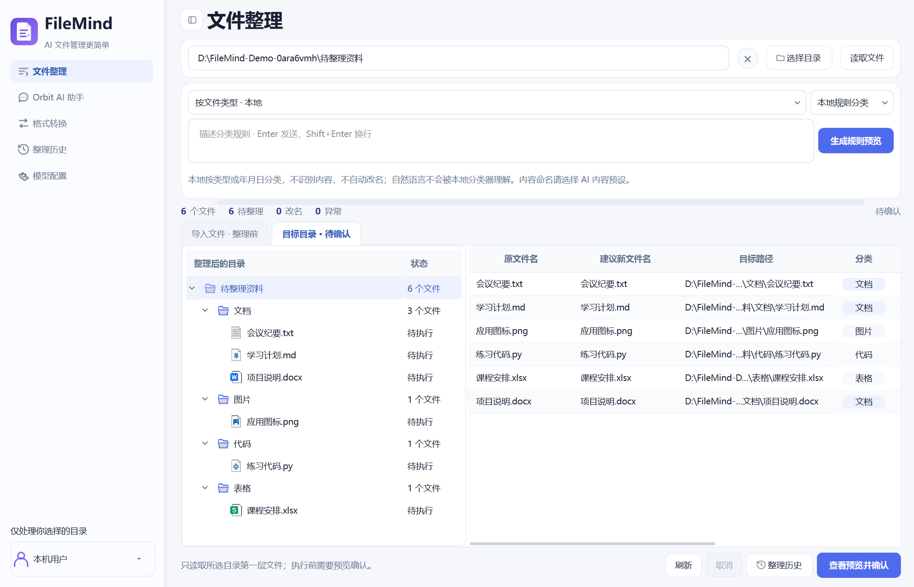
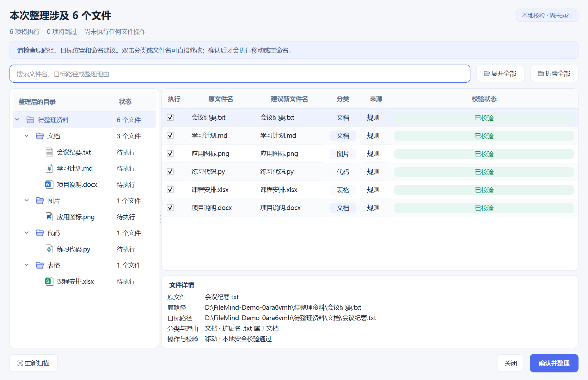
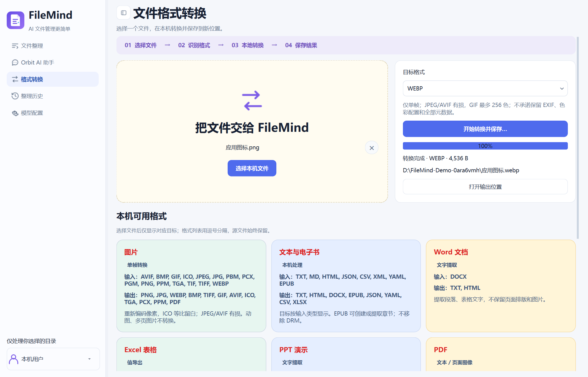

<p align="center">
  
</p>

# FileMind

**为 Windows 用户提供可预览、可确认、可撤销的文件整理流程。**

FileMind 是使用 Python 与 PySide6 构建的桌面应用。你可以用本地规则分类文件，也可以让配置好的 AI 服务提供分类和命名建议，在核对预览后执行整理。应用还提供 Orbit AI 助手和本地格式转换工具。

**[下载 Windows 安装包](https://github.com/Frank2918/FileMind/releases)** · [快速开始](#快速开始) · [从源码运行](#从源码运行) · [English](#english)

Windows 10 / 11 · x64 安装包 · Python 3.13+ · PySide6 / Qt Widgets · [MIT License](LICENSE)

## 目录

- [下载与安装](#下载与安装)
- [软件截图](#软件截图)
- [核心功能](#核心功能)
- [快速开始](#快速开始)
- [格式转换范围](#格式转换范围)
- [从源码运行](#从源码运行)
- [项目结构](#项目结构)
- [安全与隐私](#安全与隐私)
- [当前限制与路线图](#当前限制与路线图)
- [常见问题](#常见问题)
- [开发与贡献](#开发与贡献)
- [许可证](#许可证)
- [English](#english)

## 下载与安装

普通用户直接安装 Windows 程序即可，**无需另行安装 Python**。

1. 打开 **[GitHub Releases](https://github.com/Frank2918/FileMind/releases)**。
2. 展开版本下的 **Assets**，下载名称包含 `FileMind-Setup` 的 `.exe` 安装程序。
3. 运行安装程序，阅读许可说明，选择安装位置及快捷方式选项。
4. 安装完成后启动 FileMind，或从开始菜单、已创建的桌面快捷方式启动。

首个发布版本为 **[v0.1.0 — Windows 桌面版](https://github.com/Frank2918/FileMind/releases/tag/v0.1.0)**，其安装包为：

```text
FileMind-Setup-0.1.0-x64.exe
```

默认安装位置为 `%LOCALAPPDATA%\Programs\FileMind`，安装程序按当前用户安装；开机启动是可选项，默认关闭。

GitHub 自动提供的 `Source code (zip)` / `Source code (tar.gz)` 是源码归档。当前 v0.1.0 的应用附件是上述 Setup EXE；如果后续提供便携 ZIP，需要完整解压后使用，不能单独拿出 PyInstaller 目录中的 `FileMind.exe` 运行。

本文介绍当前仓库源码的能力；已安装版本的具体变化请以对应 Release 说明为准。

## 软件截图

以下截图来自当前源码在 Windows 上运行的真实界面。文件、路径与对话均使用隔离的演示数据，不含个人配置或真实聊天；Orbit 的示例回答用于展示排版，并未调用线上 AI。

### 文件整理工作区

本地规则生成待确认的分类计划，可在目录树与文件清单中核对目标位置。



<details>
<summary>整理预览：逐项核对、编辑与确认执行</summary>

预览显示执行勾选、分类、建议文件名和本地校验状态；此图中的文件尚未移动。



</details>

<details>
<summary>Orbit AI 助手：示例对话、Markdown 与最近会话</summary>

使用本地示例对话展示聊天头像、Markdown 回答与会话列表，不代表真实模型调用结果。


</details>

<details>
<summary>格式转换：PNG 转 WebP 的实际完成结果</summary>

使用项目图标的副本，在本机实际完成 PNG → WebP 转换；界面同时展示当前可用格式。



</details>

## 核心功能

| 功能 | 已实现的内容 |
| --- | --- |
| 本地文件整理 | 读取所选目录第一层普通文件，按文件类型或修改年月日分类；本地规则不需要 API Key |
| AI 分类与命名 | 根据文件元数据和规则生成建议；另外提供需逐次授权的内容识别与命名 |
| 整理预览与编辑 | 目标目录树、详情联动与搜索；核对建议路径，逐条修改分类或新文件名，或排除某个文件 |
| 确认执行与撤销 | 执行前确认；冲突项逐条跳过，记录成功、跳过和失败结果，并支持有条件的撤销 |
| Orbit AI 助手 | Markdown 回答、新建与切换会话、标题搜索、删除确认、停止与重试，以及手动选择的受限附件 |
| 模型配置 | OpenAI Chat Completions 兼容服务、本机 Ollama 模型检测、连接测试，以及 1–4 个模型的并行对话 |
| 本地格式转换 | 图片、文本与结构化数据、EPUB、PDF、Office 文字导出、音视频、字体容器和单文件 ZIP |
| 本机账户与外观 | 本机密码与恢复码、锁屏、用户名与头像、浅色 / 深色 / 跟随系统 / 绿色 / 橙色主题 |

AI 返回的是待审阅的建议。文件移动由本地执行器完成，不会让模型直接执行 Shell 命令或操作磁盘。

## 快速开始

### 1. 首次启动

首次启动需设置至少 8 个字符的本机密码，并保存一次性显示的恢复码。之后解锁即可进入工作区。

左下角账户菜单可修改用户名、头像和密码，或打开通用设置。`Ctrl+L` 用于锁定，`Ctrl+B` 用于收起或展开侧栏，`Ctrl+,` 打开通用设置。锁定前需完成或停止正在运行的任务。

本机密码用于应用锁屏，不是 AI 服务的账号密码，也不会用于加密你的原始文件。

### 2. 用本地规则整理文件

1. 打开 **文件整理**，点击 **选择目录**，核对导入文件列表；需要时点击 **读取文件** 刷新。
2. 选择 **按文件类型 · 本地** 或 **按修改年月日 · 本地**。
3. 点击 **生成规则预览**，检查目标目录树、文件名和目标路径。
4. 点击 **查看预览并确认**，按需逐条编辑或排除文件。
5. 确认执行后，应用移动通过本地校验的文件；已有目标文件不会被覆盖。
6. 在 **整理历史** 查看结果。需要撤销时，重新选择原目录并核对对应记录。

整理后的文件如果发生变化，或原位置已经存在同名文件，撤销会拒绝覆盖并报告原因。历史记录不能替代独立备份。

### 3. 配置 AI 服务

打开左侧 **模型配置**，按服务商实际提供的信息填写：

| 界面字段 | 填写内容 |
| --- | --- |
| 服务商 | 选择对应预设，或使用自定义 OpenAI 兼容接口 |
| Base URL | 服务商提供的 Chat Completions 兼容 API 基础地址；不要填写聊天网站首页 |
| 模型名称 | 账户实际可用的模型 ID，不一定等于模型的宣传名称 |
| API Key | 你自己的 API 密钥；云端服务通常需要密钥及相应调用权限 |
| 请求超时 | 按网络和模型响应时间调整 |

点击 **保存配置** 后再 **测试连接**。测试会真实访问所选接口，可能产生服务商调用费用；保存成功不代表连接已验证。

服务商预设包含 DeepSeek、OpenAI、硅基流动、阿里云百炼、智谱、千帆、Kimi、豆包、火山引擎、千问、混元等。它们共用兼容接口适配，并不代表所有模型、区域及服务商专有 API 都已经验证。

- **云端 AI**：用于 AI 分类、内容识别和 Orbit 对话，需要可用的网络、接口和账户权限。
- **本机 Ollama**：需要先安装并启动 Ollama、准备模型，再点击 **检测本机模型**。此入口仅允许回环地址，不要求 API Key；是否调用云端仍取决于 Ollama 自身配置。
- **多模型对话**：在配置页添加、勾选并保存模型，启用并行模式后，可在 Orbit 中同时请求 1–4 个模型。发送前会确认实际接口范围；并行模式暂不发送附件。

### 4. 使用 AI 分类或 Orbit

**AI 整理**：在文件整理页选择带 `AI` 的规则，输入要求并生成建议。若希望根据正文或图片为编号、哈希文件名生成新名称，选择 **按内容分类与命名 · AI**，检查“应用 AI 改名”选项，并确认本次内容发送范围。

内容识别会读取受限的文档片段或图片缩略图，不代表理解整份文件。结果仍需预览、校验和确认后才会执行。

**Orbit 对话**：进入 **Orbit AI 助手**，输入消息，`Enter` 发送，`Shift+Enter` 换行。会话保存在本机，最近列表最多保留 200 段；可按标题搜索、切换或删除。

附件必须主动选择并在发送前确认。目前支持受限的 UTF-8 文本 / 代码和部分图片；每次最多 5 个，单个不超过 4 MB，总计不超过 12 MB。图片输入受模型适配限制，PDF 和 Office 文件不能直接作为 Orbit 附件发送。

### 5. 转换文件格式

进入 **格式转换**，选择或拖入一个普通文件，等待识别后选择目标，点击 **开始转换并保存…** 并指定新的输出位置。

可用目标按实际输入和本机后端显示。源文件保留，已有输出不覆盖；选择区的 `×` 只清除当前选择，不删除文件。

## 格式转换范围

| 类别 | 已实现的转换示例 | 主要边界 |
| --- | --- | --- |
| 图片 | PNG, JPEG, WebP, TIFF, BMP, GIF, AVIF 等格式重新编码，图片生成单页 PDF | 以已安装编码器为准；只处理单帧输入，不支持 RAW / HEIC |
| 文本与结构化数据 | UTF-8 / UTF-16, TXT, HTML, DOCX, CSV ↔ JSON, JSON ↔ YAML, CSV → XLSX | 输入编码受限；JSON 转 CSV 需要扁平对象数组，不复刻复杂排版 |
| EPUB | 从文本创建 EPUB，或按阅读顺序提取 EPUB 章节文字 | 不处理 DRM，不读取外链 |
| PDF | 文本层提取为 TXT, DOCX, HTML；页面渲染为 PNG / JPEG ZIP | 最多 100 页；无 OCR，文本重建不保留原版面、图片与表格结构 |
| Office 内容 | DOCX / PPTX → TXT, HTML；XLSX → JSON, 多 CSV ZIP | 提取文字或已有单元格值，不计算公式，不保证原样式 |
| 音视频 | MP3, WAV, FLAC, OGG 等音频重编码；MP4, WebM, MKV 等视频重编码及音轨提取 | 依赖可用 FFmpeg 编码器；不保留全部字幕、多轨和元数据 |
| 字体容器 | TTF / OTF → WOFF / WOFF2，WOFF / WOFF2 → 原始字形类型的 TTF / OTF | 不做 TTF 与 CFF 轮廓互转；需遵守字体自身许可 |
| 普通文件 | 将一个文件另存为 ZIP | 不递归压缩目录，不提供解压功能 |

单个输入一般不超过 64 MB，文本转换不超过 8 MB，字体另有更严格限制。转换在本机进行，不调用 AI。

检测到 LibreOffice 后，界面还会提供 **实验性 Office 排版转换**。LibreOffice 不随应用安装；该能力需要另行安装并核对字体、版式和公式结果，不能视为已保证的原样转换。

## 从源码运行

以下命令用于 **Windows PowerShell**，以项目根目录的 `main.py` 为启动入口。

- 项目元数据要求 **Python >= 3.13**；当前 CI 和 Windows 打包使用 Python 3.13 x64。
- 运行依赖以 [requirements.txt](requirements.txt) 为准；[pyproject.toml](pyproject.toml) 从同一文件读取依赖。
- 直接使用虚拟环境里的解释器，无需激活环境或调整 PowerShell 执行策略。

```powershell
git clone https://github.com/Frank2918/FileMind.git
Set-Location FileMind

py -3.13 -m venv .venv
.\.venv\Scripts\python.exe -m pip install --upgrade pip
.\.venv\Scripts\python.exe -m pip install -r requirements.txt
.\.venv\Scripts\python.exe main.py
```

已克隆项目时，在自己的项目目录中执行创建虚拟环境及后续命令，不要重复覆盖现有工作区。

主要技术组成：

| 部分 | 技术 |
| --- | --- |
| 桌面界面 | PySide6-Essentials 6.12.0, Qt Widgets, QSS |
| AI 接口 | OpenAI Python SDK，Chat Completions 兼容协议 |
| 本地转换 | Pillow, PDFium, python-docx, openpyxl, python-pptx, PyYAML, defusedxml, FFmpeg, fontTools, Brotli |
| 构建与安装 | PyInstaller onedir, Inno Setup |
| 测试 | pytest, Qt Test |

### 构建 Windows 安装程序

需要 Inno Setup 6.5 或更新版本。在仓库根目录执行：

```powershell
.\scripts\build-windows.ps1 -Stage Prepare
.\scripts\build-windows.ps1 -Stage Bundle
.\scripts\build-windows.ps1 -Stage Installer
```

`Prepare` 创建独立的 `.venv-build`，按发布锁文件安装依赖；`Bundle` 生成完整 onedir；`Installer` 编译安装程序并整理发布材料。也可在 Inno Setup Compiler 中打开 `packaging\FileMind.iss` 手动编译。

编译器路径、安装向导、自检和发布材料说明见 **[正式 Windows 发布流程](docs/RELEASE_PIPELINE.md)**。构建产物不应提交进源码仓库。

## 项目结构

```text
FileMind/
├── main.py                  # 桌面启动入口，也支持显式离线自检
├── filemind/
│   ├── ai/                  # 模型适配、提示词、内容读取与附件处理
│   ├── core/                # 扫描、分类、计划校验、编辑、执行与撤销
│   ├── conversion/          # 本地格式识别和转换后端
│   ├── models/              # 文件与整理计划等数据模型
│   ├── storage/             # 设置、凭据、历史、锁屏与工作区偏好
│   └── ui/                  # Qt 窗口、页面、对话框、组件、图标与 QSS
├── tests/                   # 核心逻辑、UI、协议与发布配置测试
├── tools/                   # 图标导出、界面审查与发布辅助工具
├── scripts/                 # Windows 发布入口脚本
├── packaging/               # PyInstaller / Inno Setup 配置及依赖锁文件
├── docs/                    # 发布流程与设计、整合记录
├── .github/workflows/       # CI 与 Windows 发布工作流
├── requirements.txt         # 应用运行依赖
├── requirements-dev.txt     # 开发与测试依赖
├── pyproject.toml           # 包元数据、Python 要求与测试配置
└── LICENSE                  # 项目 MIT 许可证
```

## 安全与隐私

### 文件处理与外部请求

| 操作 | 本地处理与发送范围 |
| --- | --- |
| 文件扫描、本地规则整理 | 扫描所选目录第一层文件；扫描和分类不读取正文，也不向模型发请求 |
| 基于文件名的 AI 整理 | 经确认后发送文件标识、文件名、扩展名、大小、修改时间及整理规则；不发送正文和本地绝对路径 |
| 按内容分类与命名 | 每次另行确认后，再发送受限文档片段或图片缩略图，以及相应元数据；文档最多取开头 1800 字，PDF 最多读取前三页 |
| Orbit 对话 | 向所选接口发送消息、系统提示词和当前会话最近最多 20 条上下文；多模型模式会分别发送给各选中接口 |
| Orbit 附件 | 发送前单独确认；所选文本或图片内容会发送给当前模型服务 |
| 格式转换 | 本地转换流程不调用 AI，也不发起网络请求 |

内容识别会排除部分疑似凭据文件并遮蔽部分常见凭据模式，但不能保证识别所有敏感信息。图片中的个人信息仍可能可见，请在授权前检查所选文件。云端服务如何保留和处理请求，以该服务的条款与隐私政策为准。

本地计划器检查文件名、相对路径和目标冲突，执行器不覆盖已有文件。整理会实际移动或重命名文件；重要资料请先备份。

### 本地数据与密钥

Windows 默认数据位置如下：

| 位置 | 内容 |
| --- | --- |
| `%APPDATA%\FileMind\settings.json` | 模型与界面设置等普通配置 |
| `%APPDATA%\FileMind\chat_history.json` | Orbit 消息、时间戳与附件名称；不保存附件正文或本地附件路径 |
| `%LOCALAPPDATA%\FileMind\` | 用户名、头像、布局偏好及锁屏相关数据 |
| 所选目录下的 `.filemind\history\` | 整理操作记录，包含文件本地路径及执行、撤销状态 |

API Key 默认保存在 **Windows 凭据管理器**，也支持服务商环境变量。显式启用“在本机配置文件中明文保存密钥”时，会写入用户配置目录中的 `local_api_keys.json`，存在明文风险。

聊天和整理历史是本地 JSON 数据，并未提供整体加密。本机密码保存验证值，记住解锁令牌在 Windows 下使用 DPAPI 保护；应用锁屏不等于磁盘加密。不要把 `.env`、用户数据、密钥文件或真实聊天记录提交到 Git，也不要随安装包分发。

## 当前限制与路线图

当前版本的边界：

- 扫描仅覆盖所选目录第一层，不递归遍历或监控整个磁盘。
- 未提供网页采集、扫描版 PDF OCR 或通用图片文字识别功能。
- Office 内置转换以文字和单元格值导出为主；LibreOffice 排版转换为可选实验能力。
- 云端模型能力和账户授权由服务商决定；没有通用多模态能力自动探测，不支持只提供 Responses API 或其他专有协议的接口。
- Orbit 不能直接接收 PDF / Office 附件；图片输入受当前模型适配限制。

后续拟完善的方向，具体范围以 Issue 和后续版本说明为准：

- 补充更多操作示例与简短使用演示。
- 扩大转换格式和复杂文档的兼容性验证。
- 完善安装、升级、不同 DPI 与代码签名的发布验证。
- 改进更多模型接口的兼容性与错误提示。

## 常见问题

### 下载后应该运行哪个文件？

普通用户下载 Release 的 `FileMind-Setup-*.exe`。源码 ZIP 不包含可直接安装的程序；PyInstaller 输出目录中的 EXE 也依赖配套文件。

### 源码运行提示找不到模块或 Qt 依赖怎么办？

检查是否使用 Python 3.13 及以上，并使用同一个虚拟环境安装依赖和启动程序：

```powershell
.\.venv\Scripts\python.exe --version
.\.venv\Scripts\python.exe -m pip check
.\.venv\Scripts\python.exe main.py
```

若安装版无法启动，请记录 Windows 版本、下载的安装包名称和错误截图后提交 Issue；不要提供密钥或真实聊天数据。

### AI 配置保存了，为什么仍然连接失败？

先确认 **模型配置** 页面已保存正确的服务商、Base URL、模型 ID 与 API Key，再测试连接。代码会区分密钥或权限问题、地址 / 模型不存在、限流或额度不足、超时及服务端错误。请按实际提示检查服务商控制台、账户额度和网络；配置预设不代表账户已有模型权限。

### 为什么选了文件却没有预期的转换格式？

目标由输入格式、本机编码器和后端决定。扫描 PDF 没有文本层时无法直接提取文字；Office 内置文字导出不等同于保留版面的文档转换。LibreOffice 相关目标只在检测到该程序后出现。

### 为什么有的文件被跳过，或不能撤销？

在预览与历史中查看逐项原因。常见情况包括目标已存在、用户排除、路径校验失败、AI 建议不完整，以及文件在整理后发生变化。解决冲突后重新生成计划；不要通过覆盖原文件来绕过检查。

### 忘记本机密码怎么办？

在解锁页使用首次设置时保存的恢复码重设密码。应用没有密码与恢复码均遗失时的内置绕过入口，请勿为解锁而随意删除用户数据。

## 开发与贡献

欢迎通过 [Issues](https://github.com/Frank2918/FileMind/issues) 报告问题或提出建议，也欢迎提交 Pull Request。

1. 先描述使用场景、预期行为和复现步骤，较大改动建议先在 Issue 中讨论。
2. 使用独立分支，保持改动范围集中，为行为变更补充相关测试。
3. 提交前核对差异，排除真实密钥、个人文件、聊天记录和构建产物。

在已建立的开发虚拟环境中，可手动运行：

```powershell
.\.venv\Scripts\python.exe -m pip install -r requirements-dev.txt
.\.venv\Scripts\python.exe -m pytest -q
```

CI 配置覆盖 Windows、Ubuntu、macOS 的 Python 3.13 测试与包资源检查；当前发布的桌面安装程序面向 Windows。测试使用临时数据、模拟服务与本机协议夹具，不需要真实 API Key。

## 许可证

项目自有代码按 **[MIT License](LICENSE)** 发布。贡献和再分发时请保留许可证要求的版权及许可声明。

Qt / PySide6、FFmpeg、PDFium 等第三方组件遵循各自许可证，项目的 MIT 许可不替代它们的授权条件。安装包维护者还需根据实际捆绑二进制履行相应的许可和源码提供义务，详见 [第三方许可证说明](packaging/licenses/README.md)。

## English

**FileMind is a Windows desktop application for reviewing and organizing local files, with an optional AI assistant and local format conversion.**

[Screenshots](#软件截图) show the real Windows application with isolated demo files and sample conversations. The sample chat is illustrative, with no live AI request; the PNG-to-WebP conversion was actually performed locally.

### Features

- Organize top-level files by type or modification date using local rules.
- Request AI classification and naming suggestions, with separate consent for bounded content analysis.
- Review and edit a plan before confirming file moves; inspect history and undo eligible operations without overwriting existing files.
- Chat with Orbit, manage local conversations, and optionally query 1–4 configured models in parallel.
- Convert supported images, text, structured data, EPUB, PDF, Office content, media and font containers locally. LibreOffice layout conversion is optional and experimental.
- Configure a local password, username, avatar and appearance.

### Install or run from source

Download the Windows installer from **[GitHub Releases](https://github.com/Frank2918/FileMind/releases)**. The first published Windows release is **[v0.1.0](https://github.com/Frank2918/FileMind/releases/tag/v0.1.0)**; choose `FileMind-Setup-0.1.0-x64.exe`, run the installer and launch FileMind. Python is not required for the installer version.

For source development, use Python 3.13 or later and follow the [PowerShell setup commands above](#从源码运行). Runtime dependencies are defined in `requirements.txt`; the desktop entry point is `main.py`.

Cloud AI features require a configured endpoint, model and API Key. Local Ollama requires a running service and an installed model, but no API Key. Review the [privacy section](#安全与隐私): AI requests can send metadata, conversation text and explicitly approved file content to the selected endpoints. Local chat history is not encrypted by the application. Scanned-PDF OCR and web collection are not implemented.

Licensed under [MIT](LICENSE) for project code; bundled third-party components retain their own license terms.
